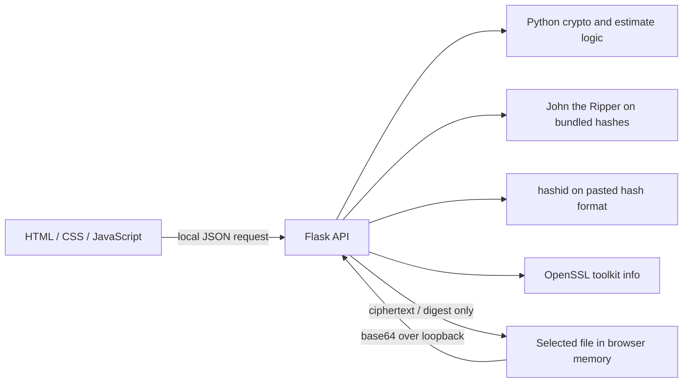

# CryptoGuard

**A password and file-security workbench that turns crypto choices into things you can inspect.**


CryptoGuard brings password checks, local secret generation, authenticated file encryption, file hashes, and one bounded password-cracking demonstration into a single interactive app. It is the first project in a year-by-year security portfolio: focused on applied cryptography and careful handling of user input.

## Problem / why it matters

People often see “strong password” meters without understanding their assumptions, or use checksums as if they protected confidentiality. The workbench explains the difference, shows the estimate model, and lets a user compare encryption and integrity operations on a file they choose.

## What I built

- Password strength score, entropy estimate, policy checks, predictable-pattern checks, and rough guess-rate scenarios.
- Strong password and passphrase generators backed by Python's `secrets` module.
- AES-256-GCM file/text encryption with PBKDF2-HMAC-SHA256; an authenticated `.cguard` envelope can be downloaded and decrypted later.
- SHA-256, SHA-1, and MD5 fingerprints, plus format hints using `hashid` when available.
- A John the Ripper demo limited to the bundled sample hashes and wordlist.
- A responsive workbench with visible progress, tool status, download/print report controls, and independent sections for each task.

### Architecture



## Tools used

| Tool | Purpose |
|---|---|
| Python `cryptography` | AES-256-GCM and PBKDF2-HMAC-SHA256 |
| John the Ripper | Crack only the bundled sample hashes with the bundled wordlist |
| `hashid` | Optional hash-format identification; a small heuristic is the local fallback |
| OpenSSL | Report installed toolkit version and available cipher names |
| Flask | Local API for the interactive workbench |

## Run it

### Docker (recommended)

Requires Docker Desktop with Compose.

```bash
docker compose up --build -d
open http://localhost:8101
docker compose down
```

Double-click `Start.command` on macOS to start Docker if needed, wait for the health endpoint, and open the dashboard. The app port is bound to `127.0.0.1`.

### Local Python

```bash
python3 -m venv .venv
source .venv/bin/activate
python -m pip install -r requirements.txt
make test
make run
```

Open `http://127.0.0.1:8000`.

## Results / evaluation

`make test` checks weak-versus-longer-password behavior, AES-GCM round trips and tamper rejection, hash helpers, API validation, and generator bounds. The John panel reports the live result from the installed tool against the checked-in sample set. Its count is a demonstration result, not a password-strength benchmark.

Password crack-time bars are **estimates** based on simplified guess rates and a theoretical keyspace. They do not account for a real person's password habits, leaked credentials, attacker hardware, or every password-hashing scheme. Always use unique credentials and MFA.

## What I learned / design decisions

- A message authentication tag matters: GCM rejects a modified ciphertext or wrong key instead of returning unauthenticated bytes.
- Salt and nonce are safe to store beside ciphertext; the passphrase is not included in the envelope.
- A password score can mislead if its attacker model is hidden, so the UI shows the guess-rate assumptions and calls the time a rough estimate.
- The cracking demo is intentionally scoped to repository fixtures. It does not accept an arbitrary hash file or remote target.
- Selected files travel from the browser to the local Flask process for a single request; the app does not write them to disk or retain them.

## Limitations & next steps

The password estimate is a teaching heuristic rather than a formal estimator such as zxcvbn. The passphrase list is intentionally small. The app is a local educational prototype and has not undergone a security audit; do not use it as a remote file-encryption service. A useful next step is a separately reviewed, versioned envelope format with stronger input-size controls and independent interoperability tests.

## Scope and safety

All operations use user-provided input or bundled sample data. John only reads `cryptoguard/data/sample_hashes.txt` and `cryptoguard/data/wordlist.txt`. The UI never opens a URL or contacts a third-party service. The project is an educational security tool, not a production password manager.

## License

MIT. See [`LICENSE`](LICENSE).
