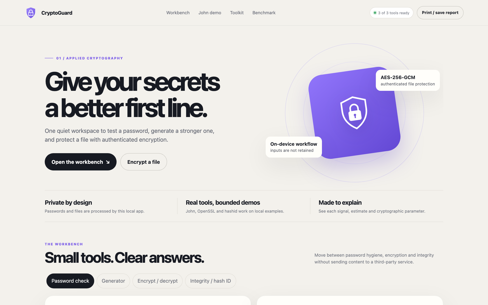

# CryptoGuard

CryptoGuard is a local app for checking passwords, making passwords and passphrases, encrypting files, and comparing password storage methods. It also has a small John the Ripper demo that uses sample data.

Design Project I, Semester III (2024–25), B.Tech Cyber Security, Hindustan Institute of Technology and Science. Project by Malepati Sree Harsha.



## What it does

- Checks password length, patterns, and common words. It shows how the estimate changes at different guessing speeds.
- Makes passwords with 12 to 64 characters or passphrases with 4 to 8 words.
- Encrypts files with AES-256-GCM. It uses PBKDF2 to make the key and rejects changed files or a wrong passphrase.
- Makes file hashes and checks common hash formats.
- Runs John the Ripper only on the sample hashes and word list in this project.
- Measures several password storage methods on the computer running the app.

## Results from one test

In a one-core Docker test, PBKDF2-SHA256 with 600,000 rounds took about 231,328 times longer than MD5. That is about 2.7 extra random characters in a 95-character set. The speed depends on the computer.

| Check | Result |
|---|---:|
| Sample hashes found by John the Ripper | 8 of 9 |
| Automated tests | 14 passed |
| Password check speed under load | 1,535 requests per second |

The sample hashes are for learning. They are not real account passwords.

## Run it

With Docker:

```bash
docker compose up --build -d
open http://localhost:8101
docker compose down
```

Without Docker:

```bash
python3 -m venv .venv
source .venv/bin/activate
python -m pip install -r requirements.txt
make test
make run
```

The app uses the local computer. See [SECURITY.md](SECURITY.md) for how it handles requests and files.

## Limits

This is a learning project and has not had an outside security review. The password score is an estimate and can rate some word patterns too highly. The speed test uses one CPU core. It does not show how fast a graphics card can test weak hashes.

## More information

- [Project overview](PROJECT_OVERVIEW.md)
- [Screenshots and diagrams](docs/README.md)
- [Security notes](SECURITY.md)
- [Full project report](report/CryptoGuard_Project_Report.pdf)

The code is under the MIT license. The sample hashes and word list are made-up examples.
