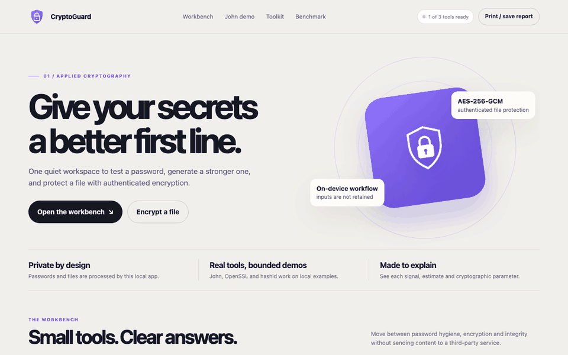
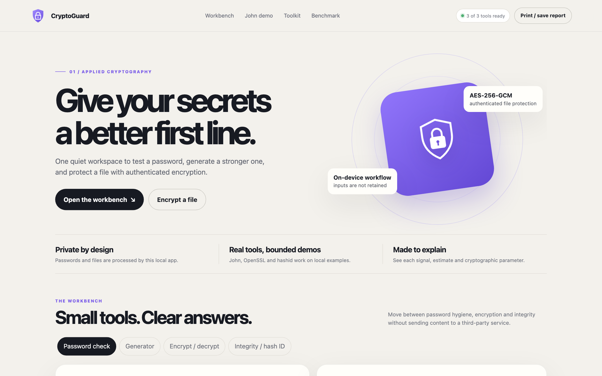
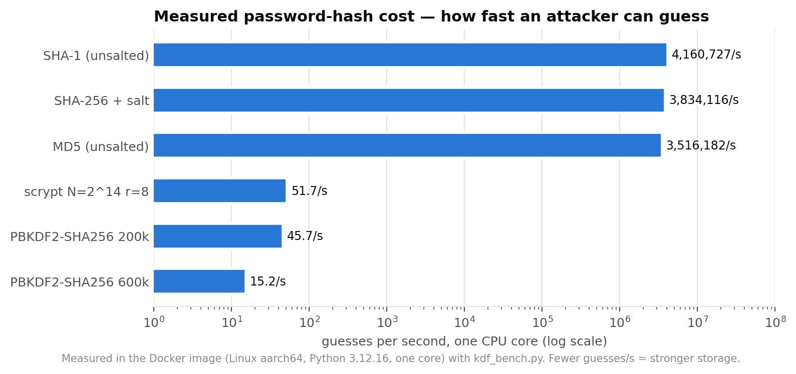
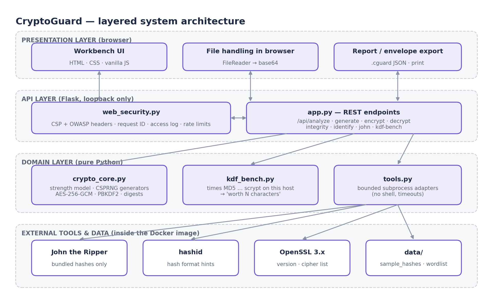

# CryptoGuard



The walkthrough uses disposable demo-only strings; never enter a password you use on another service.

**A measured password and file-security workbench.**

Design Project I · Semester III (2024–25) · B.Tech, specialisation in Cyber Security, DISC, Hindustan Institute of Technology and Science, Chennai · by **Malepati Sree Harsha**

 [](https://codecov.io/gh/harshacreate/CryptoGuard)    



Password meters print “centuries” without saying how fast the attacker is assumed to guess. That speed depends far more on how the **server stores** the password than on one extra character. CryptoGuard is a local, private workbench for password analysis, secure generation, authenticated file encryption and a real John the Ripper demonstration. It also **measures** each password-storage scheme on your machine and expresses the cost in password characters.

## Key results (measured)

| Result | Value |
|---|---|
| Guessing slowdown, PBKDF2-SHA256 600k vs MD5 (one core, Docker image) | **231,328×** |
| Equivalent extra random characters (95-symbol alphabet) | **+2.71** |
| Weak sample hashes cracked by John the Ripper (16-word list) | **8 / 9** |
| Automated tests | **14 / 14 passing** (unit, integration, security) |
| Password-analysis latency under load | p50 4.8 ms · p95 7.8 ms · 1,535 req/s |

<details><summary>Full benchmark table (Linux aarch64, Python 3.12.16, one core)</summary>

| Scheme | Guesses / s | Slowdown vs MD5 | Worth (chars) |
|---|---|---|---|
| MD5 (unsalted) | 3,516,181.8 | ≈ 1× | — |
| SHA-1 (unsalted) | 4,160,726.7 | ≈ 1× | — |
| SHA-256 + salt | 3,834,115.7 | ≈ 1× | — |
| PBKDF2-SHA256 200k | 45.7 | 76,940× | +2.47 |
| PBKDF2-SHA256 600k | 15.2 | 231,328× | +2.71 |
| scrypt N=2^14 r=8 | 51.7 | 68,011× | +2.44 |

Ratios are the robust result; absolute speeds depend on hardware, and GPUs are far faster on fast hashes. A single-core benchmark does not show scrypt's memory-hardness advantage.
</details>



An opt-in Argon2id sample was measured on macOS arm64 at 8 MiB, one pass and
one lane: **379.7 hashes/s** over a 0.1501 s run, with 44,318,720 bytes process
peak RSS. This is a small reproducible benchmark setting, not a recommended
file-encryption profile; full platform details and the exact command are in
[the Argon2id measurement note](docs/ARGON2ID_BENCHMARK.md).

## Features

- **Explainable strength analysis:** entropy, policy checks, common-password detection, repeated / keyboard / sequential patterns, simple dictionary chunks and common l33t substitutions, with crack-time scenarios and stated guess rates.
- **Secure generation:** passwords (12–64 chars) and passphrases (4–8 words) from the OS CSPRNG (`secrets`).
- **AES-256-GCM encryption:** PBKDF2-HMAC-SHA256 (200k iterations), random salt and nonce, a versioned authenticated `.cguard` JSON envelope, and compatibility for legacy v1.0.0 files.
- **Integrity and hash ID:** SHA-256 / SHA-1 / MD5 digests; format identification with `hashid` and built-in rules.
- **John the Ripper demo:** bounded to the bundled sample hashes and word list; accepts no input.
- **Measured KDF benchmark:** times MD5, SHA-1, SHA-256, PBKDF2 (200k, 600k) and scrypt; Argon2id is an explicit opt-in and reports its configured memory, iterations, parallelism, runtime, and host platform.

## Architecture



UML, DFD and deployment diagrams are in [`docs/diagrams/`](docs/diagrams/) and explained in the [project report](report/CryptoGuard_Project_Report.pdf).

## Quick start

Run the published image:

```bash
docker run --rm -p 127.0.0.1:8101:8000 ghcr.io/harshacreate/cryptoguard:latest
```

```bash
docker compose up --build -d      # John the Ripper, hashid and OpenSSL included
open http://localhost:8101        # bound to 127.0.0.1 only
docker compose down
```

On macOS you can double-click `Start.command`. Local development without Docker:

```bash
python3 -m venv .venv && source .venv/bin/activate
python -m pip install -r requirements.txt
cp .env.example .env              # optional
make test                         # 14 tests
make run                          # http://127.0.0.1:8000
python -m cryptoguard.kdf_bench   # benchmark from the CLI
python -m cryptoguard.kdf_bench --argon2  # opt-in Argon2id (default 64 MiB, 3 passes, 1 lane)
python scripts/loadtest.py        # load test a running instance
```

## Security

Strict same-origin Content-Security-Policy and OWASP headers, request IDs, access logs that never include request bodies, JSON errors without stack traces, per-client rate limits on John and the benchmark, subprocesses without a shell, and a non-root container. See [SECURITY.md](SECURITY.md) for the threat model and how to report a vulnerability.

## Testing

`make test` runs unit tests (strength model, AES-GCM round trip and tamper rejection, generators, hash ID, KDF ordering), integration tests through Flask's test client, and security tests (headers, no-store, request-ID log-injection guard, JSON 404, HTTP 429). CI runs them on every push. Browser checks and screenshots were captured from the Docker build.

## Documentation

| Document | |
|---|---|
| [Project report (PDF)](report/CryptoGuard_Project_Report.pdf) · [Word](report/CryptoGuard_Project_Report.docx) | IEEE-style report: literature survey, SRS, UML/DFD, implementation, testing, results, references |
| [Presentation (PowerPoint)](report/CryptoGuard_Presentation.pptx) · [PDF](report/CryptoGuard_Presentation.pdf) | Review / viva slides with speaker notes |
| [Synopsis](report/CryptoGuard_Synopsis.pdf) | Two-page project synopsis |
| [Demo script](report/Demo_Script.md) | Timed live-demonstration walkthrough |
| [Viva questions](report/Viva_Questions.md) | Likely examiner / interviewer questions with answers |
| [Portfolio copy](report/Portfolio_Copy.md) | GitHub description, LinkedIn and resume text |
| [Showcase page](docs/index.html) | Landing page for GitHub Pages (Settings → Pages → `main` / `docs`) |
| [`.cguard` v1 format](docs/CGUARD_FORMAT.md) | Authenticated field definitions, legacy migration behavior, and fixed test vector |
| [Argon2id measurement](docs/ARGON2ID_BENCHMARK.md) | Recorded parameters, runtime, platform, memory and exact command |
| [Security policy](SECURITY.md) · [Contributing](CONTRIBUTING.md) · [Changelog](CHANGELOG.md) | Threat model, disclosure process, workflow, history |

## Limitations and roadmap

- The strength score is a heuristic with a small local pattern list, not a trained password estimator or a crack-time guarantee. It can miss language-specific words and combinations.
- KDF timings are single-process measurements on the current host, not attacker-wide cracking rates. Argon2id memory reports configured working memory; process RSS also includes runtime and library overhead.
- The versioned `.cguard` format is documented in [`docs/CGUARD_FORMAT.md`](docs/CGUARD_FORMAT.md); version 1 currently uses PBKDF2-HMAC-SHA256 for file encryption. Argon2id is benchmark-only.
- Educational, loopback-only tool; not independently audited.

## Repository layout

```
├── .dockerignore
├── .env.example
├── .github/
│   └── workflows/
│       └── ci.yml
├── .gitignore
├── CHANGELOG.md
├── CONTRIBUTING.md
├── Dockerfile
├── LICENSE
├── Makefile
├── PROJECT_OVERVIEW.md
├── README.md
├── SECURITY.md
├── Start.command
├── cryptoguard/
│   ├── __init__.py
│   ├── app.py
│   ├── crypto_core.py
│   ├── data/
│   │   ├── sample_hashes.txt
│   │   └── wordlist.txt
│   ├── kdf_bench.py
│   ├── static/
│   │   └── index.html
│   ├── tools.py
│   └── web_security.py
├── docker-compose.yml
├── docs/
│   ├── README.md
│   ├── diagrams/  (10 images)
│   ├── index.html
│   └── screenshots/  (6 images)
├── requirements.txt
├── scripts/
│   └── loadtest.py
└── tests/
    ├── test_cryptoguard.py
    └── test_security.py
```

## License

MIT, see [LICENSE](LICENSE). Bundled hashes and word list are synthetic teaching data.
